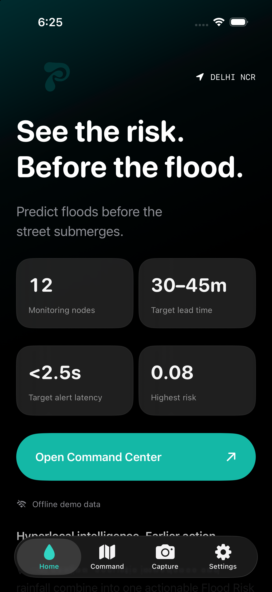

# Toodle for iOS

Toodle is a native SwiftUI app for viewing flood risk across 12 monitoring locations in Delhi NCR. It combines a location-aware map, prioritized node list, live weather, field photography, and a clearly labeled storm demonstration. It supports portrait and landscape on iPhone.



## Features

| Screen | What it shows |
| --- | --- |
| Home | Monitoring overview, highest risk, and live/offline status. Lead-time and alert-latency figures are product targets, not measured results. |
| Command Center | MapKit map centered on the user's location when permitted; standard/satellite imagery; risk-colored node markers; priority queue. Live data refreshes every 30 seconds while open. The layout adapts to landscape and larger text sizes. |
| Node details | Current Flood Risk Index (FRI), live observations collected during this session, available rain-risk input, and six-hour precipitation forecast. Unavailable sensor inputs are identified rather than fabricated. |
| Field Capture | In-app camera or photo-library selection, JPEG compression, visual analysis, and GPS freshness checks. Library photos cannot establish verified capture location. |
| Settings | HTTPS endpoint override, offline demo switch, backend health diagnostics, node directory, and sign-out. |

Clerk email/password sign-in gates the app. Sign-up checks password strength and confirms the email with a code. After a successful live alert, a feedback sheet asks about action taken 40 seconds later. If the app is backgrounded, the question waits until it returns to the foreground. A negative answer offers one more real SNS test alert through a separately protected backend route. The fixed **Send Test Alert** button on Field Capture is available only for an eligible live camera analysis with fresh, accurate GPS; a library image or simulated result cannot enable it.

The four-stage Storm Simulator advances through Clear, Moderate, Drain Choke, and Storm in about 12 seconds using reproducible demonstration values. Simulation is visibly labeled. Its optional cloud sync switch is off by default and writes demo telemetry to the configured backend only when enabled.

## Live data and risk calculation

The default HTTPS API is `https://main.d8ovyga5ca3ks.amplifyapp.com`. No AWS credentials are bundled into the app.

| Route | Purpose |
| --- | --- |
| `GET /api/nodes` | Node identity, coordinates, and any published risk or sensor fields. Live monitoring requires the DynamoDB source header. |
| `GET /api/weather` | Current node weather and six-hour precipitation forecast. Rainfall is converted to normalized rain risk. |
| `GET /api/health` | Region and backend service diagnostics. |
| `POST /api/analyze` | Photo analysis. |
| `POST /api/dispatch` | Explicit emergency dispatch request, subject to backend acceptance and cooldown. |
| `POST /api/test-alert-resend` | Real SNS feedback resend, requiring a Clerk session, server allowlist, and rate limit. |
| `POST /api/nodes` | Optional simulation telemetry sync. |

FRI is `0.55 × V + 0.35 × A + 0.10 × R`: V is visual pooling, A is acoustic impedance, and R is normalized rainfall. Risk bands are Normal (≤ 0.35), Advisory (≤ 0.65), Warning (≤ 0.85), and Critical (> 0.85). The client uses published FRI or component fields when available. The current node metadata response does not publish historical FRI, pooling, or acoustic-impedance readings. The app does not draw generated values as live sensor measurements; its history chart gathers observed responses during the current session. The weather forecast chart uses returned forecast data.

Weather detail first reads the configured API, then can use a separately attributed Open-Meteo forecast if that request fails. A failed live node request switches to clearly labeled offline demo data. The offline switch deliberately selects bundled demo data.

## Build and run

Requirements: macOS with Xcode and an iOS simulator runtime or iPhone running iOS 17 or later. The checked-in `Toodle.xcodeproj` opens directly. XcodeGen is needed only to regenerate it from `project.yml`. Xcode fetches ClerkKit through Swift Package Manager.

1. Open `Toodle.xcodeproj` in Xcode.
2. Select the `Toodle` scheme and an iPhone simulator or connected iPhone.
3. Press **Run** (⌘R). Grant location and camera access when prompted for those features.

Before running sign-in, create a Clerk application, enable **Email + Password** sign-in and sign-up, and enable **email verification by code** for sign-up. Register the iOS bundle identifier `com.toodle.ios` and the App ID Prefix for your signing team in Clerk's iOS configuration. Paste that application's **publishable key** into `CLERK_PUBLISHABLE_KEY` in both `Config/Debug.xcconfig` and `Config/Release.xcconfig`, or put `CLERK_PUBLISHABLE_KEY = pk_...` in the ignored `Config/Clerk.local.xcconfig` for local builds. Only the publishable key belongs in the app; do not put the Clerk secret key in iOS files. If your signing team uses another bundle identifier, register that value instead. The app shows a setup screen until a valid key is provided. This Clerk instance currently requires at least 15 password characters, so the sign-up checklist enforces that length in addition to upper/lowercase, number, and symbol.

The deployed API must include `/api/test-alert-resend` and set server environment variables `CLERK_JWT_KEY_B64` (the Clerk instance's public JWT verification key, PEM encoded as Base64) and `TEST_ALERT_ALLOWED_USER_IDS` (comma-separated Clerk user IDs allowed to send a real test resend), in addition to its existing SNS and DynamoDB settings. The route returns 503 until those values are configured. Its per-user/per-node 40-second rate limit is separate from the normal 15-minute dispatch cooldown. The feedback resend sends to the configured SNS topic's real subscribers, so use an appropriate test subscriber set during a demo.

For a physical iPhone, unlock and trust it, enable **Developer Mode** under **Settings → Privacy & Security**, and select your Apple development team in **Toodle → Signing & Capabilities**. If `com.toodle.ios` is unavailable to your team, set a unique bundle identifier. To refresh an installed demo after pulling changes, select the device and press ⌘R again.

If the Mac's global developer directory points to Command Line Tools, use an explicit Xcode path:

```sh
DEVELOPER_DIR=/Applications/Xcode.app/Contents/Developer xcrun swift test --package-path Packages/ToodleCore
DEVELOPER_DIR=/Applications/Xcode.app/Contents/Developer xcodebuild \
  -project Toodle.xcodeproj -scheme Toodle \
  -destination 'platform=iOS Simulator,name=iPhone 18 Pro' \
  build
```

If several simulators share a name, use a UUID from `xcrun simctl list devices available` in the destination.

## Demo and dispatch

Offline mode labels simulated analysis and dispatch and does not send SMS. The Storm Simulator is separate from live monitoring. Leave optional simulation sync off for a presentation that should not modify server data.

Live dispatch requires an explicit button action. The app previews the node and action, reports server errors rather than claiming delivery, and stores a 15-minute cooldown after acceptance. The Field Capture footer uses that same dispatch request. Verified field evidence requires an in-app camera capture and a recent, sufficiently accurate GPS fix. Actual SMS delivery, camera behavior, and permission recovery need physical-device and backend verification before operational use. Risk estimates support field inspection and do not replace official emergency guidance.

## Project layout

```text
Config/                       Build configuration and default API URL
Packages/ToodleCore/           Models, calculations, API adapters, tests
Toodle/App/                   SwiftUI entry point and app state
Toodle/Auth/                  Clerk login and auth gate
Toodle/Feedback/              Delayed alert feedback and resend UI
Toodle/Features/              Home, map, node detail, capture, dispatch, settings
Toodle/Resources/             Assets, launch screen, privacy descriptions
ToodleUITests/                UI walkthrough tests
Toodle.xcodeproj/             Checked-in Xcode project
project.yml                   XcodeGen project specification
docs/                         Architecture and demo walkthrough
```

The core package uses Foundation. The app uses SwiftUI, Observation, MapKit, Charts, CoreLocation, and AVFoundation. See [architecture](docs/ARCHITECTURE.md) and the [three-minute walkthrough](docs/DEMO_SCRIPT.md).
